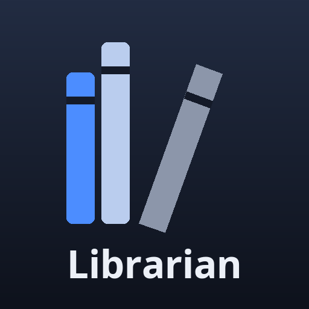
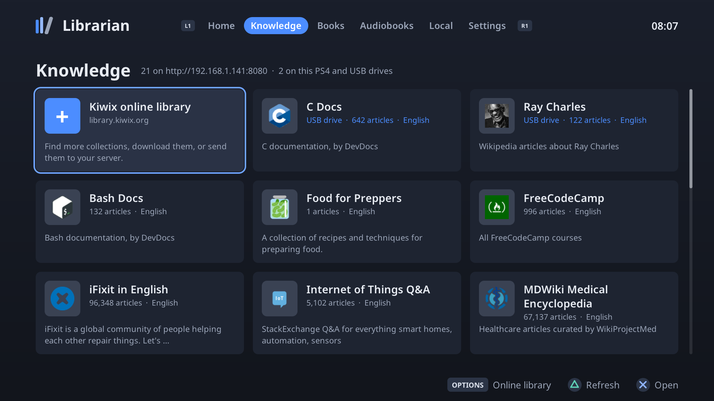
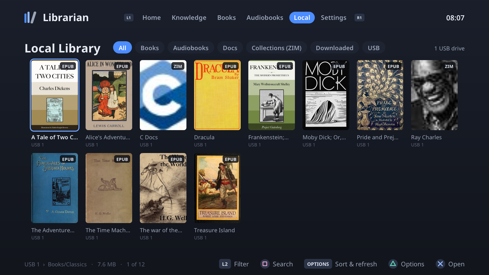
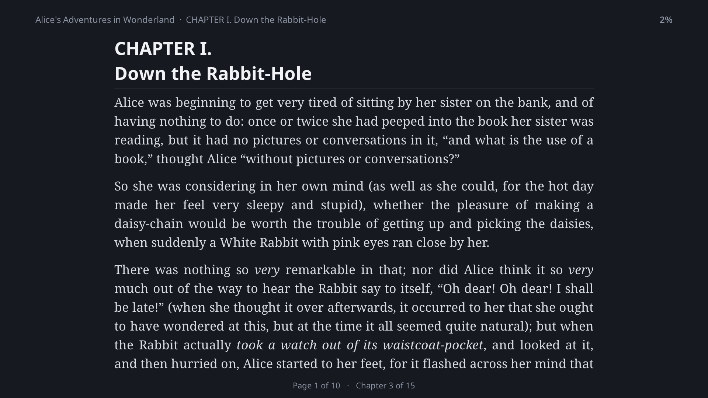
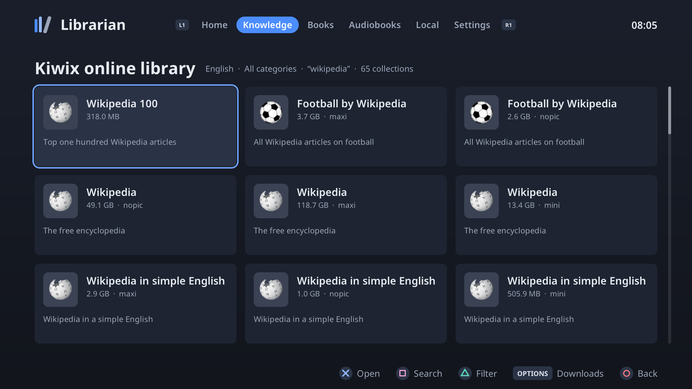
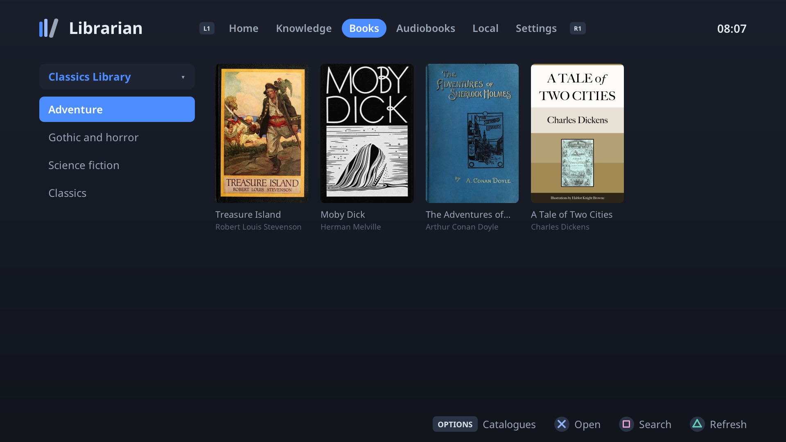
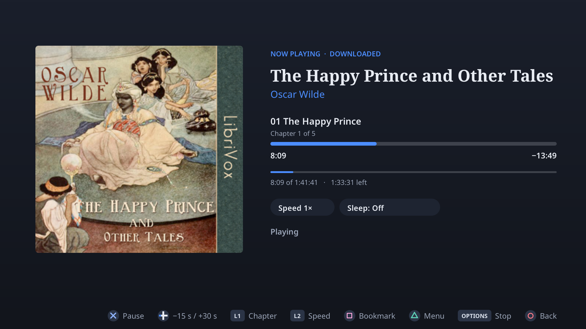
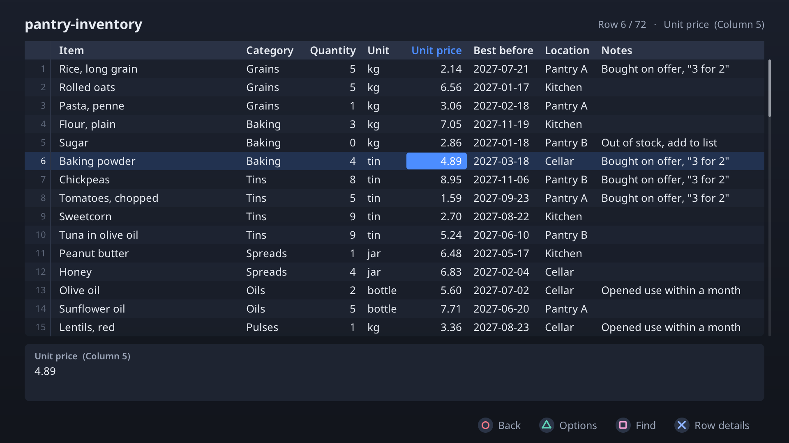
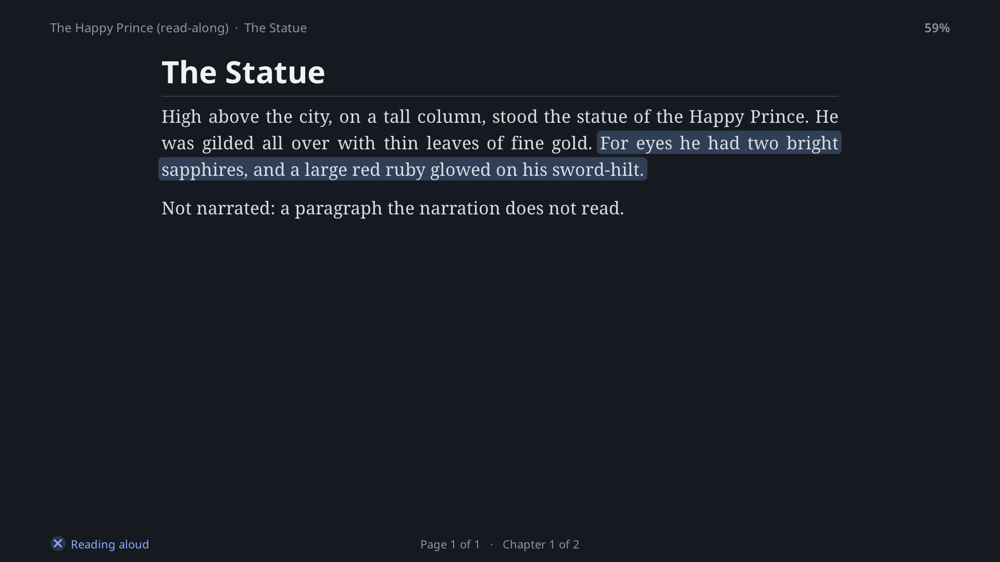

<div align="center">
  

  <h1>Librarian</h1>

  A reader for the PlayStation 4: Wikipedia and Kiwix collections, ebooks, comics, PDFs and audiobooks.

  <p>
    
    
    
    <a href="LICENSE"></a>
  </p>

  <a href="docs/MANUAL.md">Manual</a> ·
  <a href="NOTICE">Licence and credits</a> ·
  <a href="SOURCE.md">Building from source</a>
</div>

<br>

<p align="center">
  
</p>

Read Wikipedia and every other Kiwix collection, your ebooks, comics and
documents, and listen to audiobooks on a PS4. Everything is drawn by Librarian itself, at
your TV's own resolution (720p, 1080p, or 4K on a PS4 Pro), and played with the
controller, from the sofa.

It works with your own servers (**Kiwix**, **Calibre-Web**, **Audiobookshelf**),
with free online libraries that need no server at all (the **Kiwix online
library**, **Project Gutenberg**, **LibriVox**), and with files on a USB drive
or the console, with no network.

---

## Highlights

| | |
|---|---|
| 📚 **Knowledge** | Wikipedia and every other ZIM collection on your Kiwix Server, with search, links, pictures, history and bookmarks |
| 💾 **Offline Wikipedia** | ZIM files on a USB drive or the console open with no server; browse the Kiwix online library and download collections, or send them to your server |
| 📖 **Books** | Ebooks (EPUB, MOBI / AZW3, FB2) and comics (CBZ / CBR), with covers, contents, bookmarks and reading positions |
| 📄 **Docs** | PDF, Word (DOCX), OpenDocument (ODT), RTF, text, Markdown and HTML, in a Docs shelf of their own |
| 🔊 **Read-along** | EPUB 3 books with built-in narration (media overlays) and DAISY 2.02 / 3 talking books: the book reads itself aloud, highlights the passage being read and turns the pages |
| 📊 **Tables** | CSV and TSV files as a grid with a fixed header row: move cell by cell, see a whole row as a card, find and sort |
| 🌐 **Free catalogues** | Project Gutenberg and any OPDS catalogue, or your own Calibre-Web (browse, search, download, upload) |
| 🎧 **Audiobooks** | Your Audiobookshelf server, free LibriVox books, your own folders on a USB drive (MP3, M4B, FLAC, Opus, Ogg Vorbis), and talking books (read-along EPUB, DAISY) listed alongside: chapters, 0.5–3× speed that keeps voices natural, bookmarks, a sleep timer, downloads for offline listening |
| 🔌 **USB drives** | Plug in a drive and its books, docs, audiobooks and ZIM collections appear with titles and covers, sorted onto shelves (a book without a cover gets the picture beside it, or one from Open Library); progress follows a book from slot to slot |
| 🌍 **Your language** | English, 日本語, Português (Brasil), Deutsch, Français and Español; follows the PS4's language, or pick one in Settings → Appearance |
| 📺 **Every resolution** | Drawn natively at 720p, 1080p or 2160p (4K on a PS4 Pro): sharp text and pages at any size; follows the PS4, or pick one in Settings → Appearance |
| 🔐 **Private** | Passwords and keys are kept encrypted on the console |
| ⬆️ **Updates built in** | Settings → System → Software update downloads new releases, ready for the Package Installer |

---

## Screenshots

<table>
<tr>
<td width="50%" align="center">
  <br>
  <sub><b>Local</b>: everything on your USB drives and the console, with covers; L2 / R2 pick a shelf</sub>
</td>
<td width="50%" align="center">
  <br>
  <sub><b>Reader</b>: books laid out for the TV, with themes, text size and margins</sub>
</td>
</tr>
<tr>
<td width="50%" align="center">
  <br>
  <sub><b>Offline Wikipedia</b>: a ZIM file on a USB drive, read with no server</sub>
</td>
<td width="50%" align="center">
  <br>
  <sub><b>Kiwix online library</b>: find collections by language, category or name, and download them</sub>
</td>
</tr>
<tr>
<td width="50%" align="center">
  <br>
  <sub><b>Books</b>: browse Calibre-Web or any OPDS catalogue by shelf, with covers</sub>
</td>
<td width="50%" align="center">
  <br>
  <sub><b>Audiobooks</b>: chapters, speed, bookmarks and a sleep timer</sub>
</td>
</tr>
<tr>
<td width="50%" align="center">
  <br>
  <sub><b>Tables</b>: CSV and TSV as a grid with a fixed header; the selected cell in full below, the whole row with ✕</sub>
</td>
<td width="50%" align="center">
  <br>
  <sub><b>Read-along</b>: EPUB 3 books with narration and DAISY talking books; the passage being read is highlighted and pages turn by themselves</sub>
</td>
</tr>
</table>

---

## Install

**You need:** a PS4 with **GoldHEN** (2.3 or later to read USB drives). On
firmware where GoldHEN cannot lift the sandbox (seen on 14.00), turn on
**GoldHEN's FTP server**: Librarian then reads USB drives through it.

1. Download `IV0000-LIBR00001_00-LIBRARIANPS40000.pkg` from the release, or
   build it yourself (see [Building from source](SOURCE.md)).
2. Install it with GoldHEN's Package Installer (Debug Settings → Game →
   Package Installer).
3. Open **Librarian**. The welcome screen sets things up: press `X` on a step
   to start with something that needs no server (the Kiwix online library,
   Project Gutenberg, LibriVox), or to enter your own server's address.

Installing over an older version keeps your settings and library. Later
updates download from inside the app (Settings → System → Software update).

Servers can be changed at any time in Settings, on the page of their section (**Knowledge**, **Books**, **Audiobooks**), for example
`http://192.168.1.10:8080`, with *Connection* to check each one.

---

## Recommended settings

| For | Setting | Value |
|---|---|---|
| Reading on a TV across the room | Settings → Reading → **Text size** | 34 px or more |
| Reading in the dark | Settings → Appearance → **Reading theme** | Sepia or Black |
| Large downloads (books, audiobooks) | Settings → System → **Download books to** | USB drive |
| Home servers with their own certificates | Settings → System → **Self-signed certificates** | Allowed (only on your own network) |
| Your language | Settings → Appearance → **Language** | Auto (follows the PS4) |
| Faster drawing on a 4K TV | Settings → Appearance → **Resolution** | 1080p (Auto draws at 4K on a PS4 Pro) |

The [manual](docs/MANUAL.md) explains every setting and button.

---

## Controls at a glance

| Where | Buttons |
|---|---|
| **Everywhere** | D-pad / left stick move · `X` open · `O` back · `L1` / `R1` change section · `△` options · `□` search |
| **Reading** | `Left` / `Right` turn pages · `L1` / `R1` previous / next chapter · right stick moves a pointer to follow links · `L2` / `R2` select the previous / next link · `△` contents, bookmarks and settings |
| **PDFs** | `Left` / `Right` turn pages · `L2` / `R2` zoom · left stick pans · `OPTIONS` fit, rotation, continuous scrolling |
| **Comics** | `Left` / `Right` turn pages · `L2` / `R2` zoom · right stick pans · `L1` / `R1` jump 10 pages |
| **Audiobooks** | `X` pause · `Left` / `Right` −15 s / +30 s · `L1` / `R1` chapter · `L2` / `R2` speed · `□` bookmark · `OPTIONS` stop · `TOUCH PAD` opens the player from anywhere |
| **Local** | `L2` / `R2` shelf: All, Books, Audiobooks, Docs, Collections (ZIM), Downloaded, USB · `□` search · `OPTIONS` sort and refresh · `△` options (remove, delete, upload) |
| **Books** | `OPTIONS` choose the catalogue · `L2` / `R2` next catalogue |
| **Knowledge** | `OPTIONS` the Kiwix online library |

---

<details>
<summary><b>Supported formats</b></summary>

<br>

| | Supported |
|---|---|
| **Ebooks** | EPUB 2 / 3 (with read-along narration), MOBI and AZW3 (no DRM), FB2 (also zipped) |
| **Talking books** | DAISY 2.02 and DAISY 3 (full text or audio with headings), as a folder or a ZIP file |
| **Docs** | PDF (pages, zoom, fit, rotation, continuous scrolling, links, contents, bookmarks; MuPDF), Word (DOCX), OpenDocument (ODT), RTF, TXT, Markdown (with tables, task lists, footnotes and front matter), HTML |
| **Tables** | CSV and TSV (comma, semicolon, tab or bar separated; UTF-8, UTF-16 or Windows-1252), up to 24 MB and 200,000 rows |
| **Comics** | CBZ, CBR (RAR4 and RAR5) |
| **Kiwix** | ZIM collections from a Kiwix Server, or ZIM files read directly (old and new layouts, zstd or xz); interactive web-app collections cannot be shown |
| **Audiobooks** | MP3, M4A / M4B (AAC), FLAC, Opus, Ogg Vorbis (also Ogg FLAC); other formats streamed through Audiobookshelf's conversion |
| **Pictures** | JPEG, PNG, WebP, GIF, JPEG 2000 (in PDFs) |
| **Catalogues** | OPDS 1 (Atom), Calibre-Web, Kiwix's OPDS catalogue, LibriVox |

</details>

<details>
<summary><b>Troubleshooting</b></summary>

<br>

- **Something went wrong?** Turn on Settings → System → **Debug logging**, do
  it again, then read `/data/Librarian/user-<id>/librarian.log` over GoldHEN's
  FTP server (the previous run's is `librarian.prev.log`; after a crash,
  `crash.log` beside it says where). Passwords and keys are never logged.
- **A server does not answer:** press `□` on its error screen for
  troubleshooting steps, and use the console's IP address rather than a
  `.local` name.
- **USB files do not appear:** on firmware where GoldHEN cannot lift the
  sandbox, turn on GoldHEN's FTP server; Settings → System → *USB drives*
  shows how drives are reached.
- **Japanese shows as boxes:** the package's `NotoSansJP-Regular.otf` is missing
  from `/app0/assets/fonts`.

</details>

<details>
<summary><b>Building from source</b></summary>

<br>

Librarian builds with the OpenOrbis PS4 toolchain inside WSL, and also builds
for Linux, where all of its testing happens.

```powershell
python tools\fetch_deps.py --mupdf        # once: pinned dependencies
.\tools\build.ps1                         # compile, sign, package and validate
```

The result is `dist\dev\IV0000-LIBR00001_00-LIBRARIANPS40000.pkg`.
[SOURCE.md](SOURCE.md) explains rebuilding from the source release, and the
[manual](docs/MANUAL.md) covers the host build and how each part works.

</details>

---

## Credits

- [Kiwix](https://kiwix.org), [Project Gutenberg](https://www.gutenberg.org) and
  [LibriVox](https://librivox.org), whose free libraries Librarian reads
- [GoldHEN](https://github.com/GoldHEN) and the [OpenOrbis](https://github.com/OpenOrbis) toolchain
- MuPDF, libarchive, FAAD2, minimp3, dr_flac, libopus, zstd, XZ Embedded, Monocypher,
  libwebp, stb (stb_vorbis included), miniz and the Noto fonts

Every library and font, with its licence, is listed in [NOTICE](NOTICE).

## Licence

**Librarian by jw-notes.** Copyright (C) 2026 jw-notes. GPL-3.0-or-later with
the attribution terms in [NOTICE](NOTICE): keep the notices, credit "Based on
Librarian by jw-notes - https://github.com/jw-notes", and do not misrepresent
the origin. The PS4 package includes MuPDF and is distributed under the AGPL-3.0.

<sub>Librarian is an independent project and is not affiliated with Sony, Kiwix,
Calibre, Audiobookshelf, Project Gutenberg or LibriVox. PlayStation is a
trademark of Sony Interactive Entertainment.</sub>
